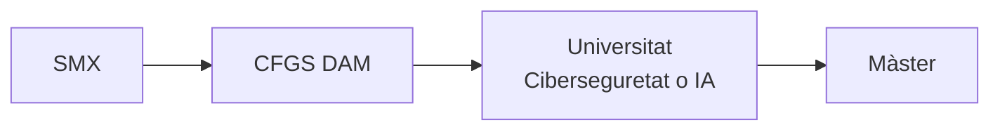

<p align="center">
  
</p>

<p align="center">
  <a href="https://www.linkedin.com/in/jordi-evstegneev-05546b408/">
    
  </a>
  <a href="https://github.com/jordievstegneev22">
    
  </a>
  <a href="mailto:alu.jordi.evstegneev@mataro.epiaedu.cat">
    
  </a>
  <br/>
  
</p>


## 🙋 Qui sóc

Tinc 17 anys i estic cursant **segon del cicle formatiu de grau mitjà de Sistemes
Microinformàtics i Xarxes** a l'Escola Pia Santa Anna de Mataró.

De petit em passava hores jugant a la PlayStation (el *Knack* és un dels jocs que
més he gaudit), però tot va canviar quan vaig tenir el meu primer ordinador. Allà
em vaig adonar que allò no era només per jugar: es podien entendre les coses per
dins i, sobretot, **crear-ne de noves**. Aquesta curiositat és la que em va portar
a estudiar informàtica.

```text
🔭  Actualment    →  2n de SMX
🌱  Aprenent      →  Python i fonaments de la programació
💬  Pregunta'm    →  sobre muntatge i manteniment d'ordinadors
🌍  Idiomes       →  Català · Castellà · Rus · Anglès
```


## 📚 Què estic estudiant

| Mòdul | Contingut principal |
|---|---|
| Muntatge i manteniment d'equips | Components, assemblatge, diagnòstic d'avaries |
| Sistemes operatius monolloc | Windows, Linux, usuaris i permisos |
| Sistemes operatius en xarxa | Servidors, dominis, recursos compartits |
| Xarxes locals | Cablejat, adreçament IP, routers i switches |
| Seguretat informàtica | Còpies de seguretat, antivirus, protecció de dades |
| Serveis de xarxa | DNS, DHCP, web, correu |

### 🎯 Què vull aprendre

- [ ] Aprofundir en **Python** i aprendre altres llenguatges de programació
- [ ] Entendre com funciona la **intel·ligència artificial** per dins
- [ ] Automatitzar tasques amb scripts
- [ ] Virtualització i administració de servidors


## 🛠️ Competències i tecnologies

<p align="center">
  
</p>

**El que sé fer:**

- 🔧 Muntar i reparar ordinadors, identificar components i detectar avaries
- 💻 Instal·lar i configurar sistemes operatius Windows i Linux
- 🌐 Configurar xarxes locals: cablejat, adreçament IP i equips de xarxa
- 🖧 Configurar serveis de xarxa com el **DHCP**
- 🐍 Programar a nivell bàsic amb Python
- 📂 Controlar versions amb **Git** i documentar amb **Markdown**


## 💻 Projectes i pràctiques

### 🖧 Configuració d'un servidor DHCP

Pràctica d'avaluació del cicle en què vaig configurar un servidor DHCP per assignar
adreces IP automàticament als equips d'una xarxa local. Em va servir per entendre
com funciona el repartiment d'adreces dins d'una xarxa i com configurar el rang
d'adreces i els paràmetres bàsics del servei.


🔗 **[Veure repositori](https://github.com/jordievstegneev22/AA2-Avaluaci-Server-DHCP)**

> 📌 Aquest apartat l'aniré ampliant amb les pràctiques i projectes que vagi fent
> durant el cicle.


## 🎯 Interessos i objectius professionals

**Què m'interessa**

- 🎮 Els videojocs: van ser la porta d'entrada al món de la informàtica
- 🤖 La intel·ligència artificial i tot el que es pot crear amb codi
- 👨‍👩‍👦 Passar temps amb la família i fer-hi plans junts

**On vull arribar**



- **A curt termini:** acabar el cicle de SMX i cursar el CFGS de Desenvolupament d'Aplicacions Multiplataforma (DAM)
- **A mitjà termini:** accedir a la universitat per especialitzar-me en ciberseguretat o intel·ligència artificial
- **A llarg termini:** completar la formació amb un màster i dedicar-me professionalment a crear coses amb la tecnologia


## 📫 Contacte

<p align="center">
  <a href="mailto:alu.jordi.evstegneev@mataro.epiaedu.cat">
    
  </a>
  <br/>
  <a href="https://www.linkedin.com/in/jordi-evstegneev-05546b408/">
    
  </a>
  <a href="https://github.com/jordievstegneev22">
    
  </a>
</p>

